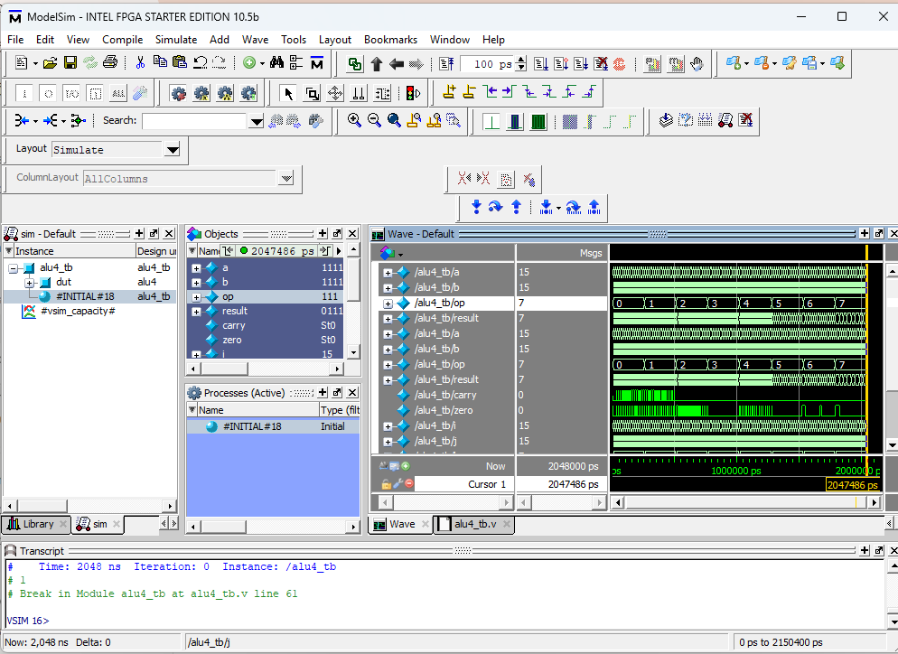
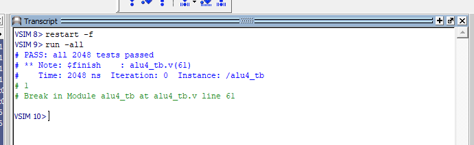

# 4-bit-ALU-verilog
4-bit ALU in Verilog with 8 operations, carry/zero flags, and a self-checking testbench (ModelSim)


## Features

- 8 operations: add, subtract, AND, OR, XOR, NOT, shift left, shift right
- Carry/borrow flag and zero flag
- Fully combinational design
- Self-checking testbench covering all 2,048 input combinations (8 ops x 16 values of A x 16 values of B)

## Interface

| Port     | Direction | Width | Description        |
|----------|-----------|-------|--------------------|
| `a`      | input     | 4     | Operand A          |
| `b`      | input     | 4     | Operand B          |
| `op`     | input     | 3     | Operation select   |
| `result` | output    | 4     | Operation result   |
| `carry`  | output    | 1     | Carry / borrow out |
| `zero`   | output    | 1     | High when `result == 0` |

## Operations

| `op` | Operation | Result    | Carry flag               |
|------|-----------|-----------|--------------------------|
| 000  | ADD       | `a + b`   | Carry out                |
| 001  | SUB       | `a - b`   | Borrow (1 when `a < b`)  |
| 010  | AND       | `a & b`   | 0                        |
| 011  | OR        | `a \| b`  | 0                        |
| 100  | XOR       | `a ^ b`   | 0                        |
| 101  | NOT       | `~a`      | 0                        |
| 110  | SHL       | `a << 1`  | 0                        |
| 111  | SHR       | `a >> 1`  | 0                        |

## Verification

The testbench (`alu4_tb.v`) loops over every combination of `op`, `a`, and `b`. For each case it computes the expected result and carry using integer arithmetic, written separately from the design, and compares them to the outputs of the ALU, along with the zero flag. It prints each failure and a final pass/fail summary.

**Result:** all 2,048 tests pass, 0 errors.



## Running the simulation

**ModelSim / Questa**
```
vlog alu4.v alu4_tb.v
vsim alu4_tb
run -all
```

Expected output:
```
PASS: all 2048 tests passed
```

## Repository structure

```
.
├── alu4.v          # ALU design
├── alu4_tb.v       # Self-checking testbench
├── waveform.png    # Simulation waveform
└── README.md
```

## Tools

Verilog, ModelSim (Intel FPGA Starter Edition 10.5b)

## Author

Alejandro Rumsey-Lanz, University of Florida, Electrical Engineering & Mathematics
